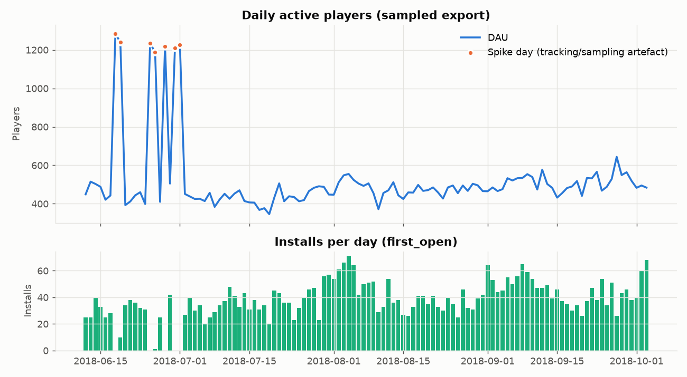
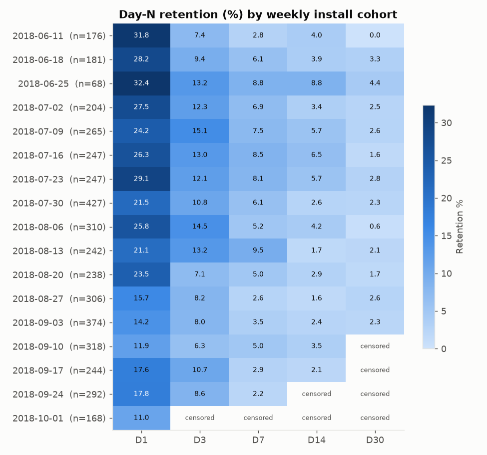
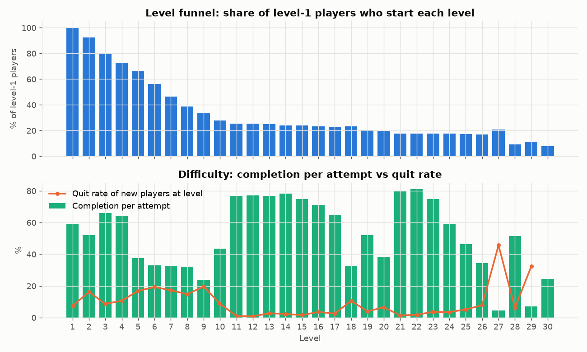
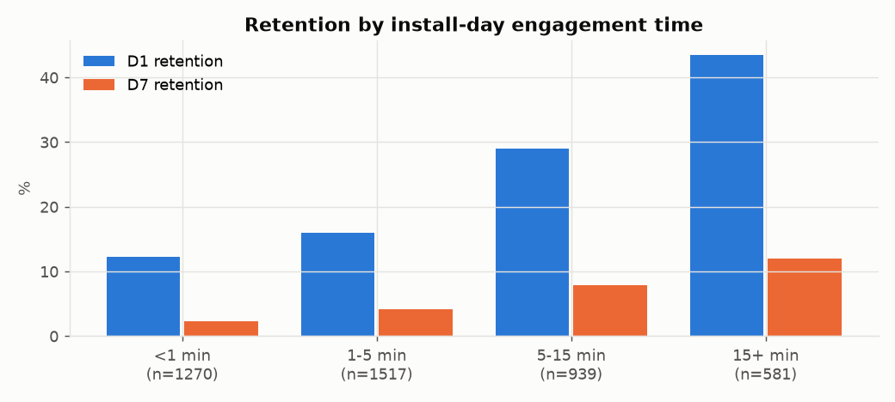
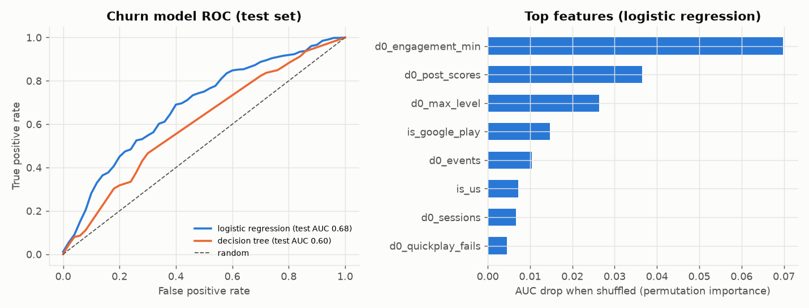

# Flood-It Mobile Game Analytics - Firebase / GA4 export on BigQuery

End-to-end, reproducible analytics pipeline on the public Firebase Analytics export of the
puzzle game **Flood-It** (`firebase-public-project.analytics_153293282.events_*`, 2018-06-12 to 2018-10-03):
growth, cohort retention, monetisation, level difficulty, player segments, churn prediction,
statistical testing and A/B-test design. Every number in this README is generated from
`results/metrics.json` by the pipeline - nothing is typed by hand.

**Interactive dashboard:** link added after publishing (stage E).
**Short report:** [reports/report.md](reports/report.md) - **Validation:** [results/validation_report.md](results/validation_report.md) (32/32 checks PASS)

## Key numbers

| Metric | Value | Definition |
|---|---|---|
| Players in window | 15,175 | distinct `user_pseudo_id` |
| Installs in cohort | 4,307 | `first_open` in window, first touch not before window |
| Avg DAU (excl. spike days) | 471 | distinct players per `event_date` |
| Stickiness (DAU/MAU) | 9.9% | days with a spike-free 30-day window |
| D1 / D7 / D30 retention | 21.5% / 5.5% / 2.1% | active on install day + N, eligible players only |
| Payer rate | 0.18% | payers / active players |
| ARPU / ARPDAU / ARPPU | $0.0021 / $0.00054 / $1.18 | IAP revenue / players, player-days, payers |
| IAP LTV D30 | $0.0027 | cumulative revenue per install, fixed population |
| Churn model AUC | 0.68 (CV 0.62 +/- 0.04) | logistic regression, install-day features |

## Insights

1. **The export is sampled, and DAU spikes are an artefact.** Every day holds exactly 50,000 events. On 7 days DAU jumps to ~1,229 (vs 471 on normal days) with ~1.6 installs: `screen_view` volume falls to 14.5% of normal, so the fixed event budget is spread over more players (41 vs 107 events per active player). Ratios are reliable; absolute counts are not.
2. **Retention is steep and getting worse.** D1 21.5%, D7 5.5%, D30 2.1% (4,307 installs, right-censored players excluded). D1 fell from 26.3% for June-July cohorts to 14.8% for September cohorts.
3. **The first session decides retention.** 29% of installs play less than 1 minute on day 0; their D7 retention is 2.3% vs 12.0% for players with 15+ minutes. Day-0 engagement time is also the top feature of the churn model (logistic regression test AUC 0.68).
4. **Level 27 is a difficulty wall.** Only 4.5% of attempts succeed (9.1 attempts per player) and 45.7% of new players who reach it stop there; levels 29 and 9 follow. Only 7.8% of level-1 players ever start level 30.
5. **IAP monetisation is negligible; the game lives on ads.** 27 purchases from 27 payers (0.18% payer rate, ARPPU $1.18); `remove_ads` is 74% of purchases. 1,912 rewarded-ad events exist but carry no revenue value, so ad revenue cannot be measured from this export.
6. **Android and Google Play users retain better on D1 (observational).** Android D1 22.7% vs iOS 18.9% (iOS - Android -3.8 pp, p = 0.005, Cohen's h -0.09 = small); within Android, google-play installs beat (direct) by +6.8 pp (p < 0.001). Not causal.
7. **A clean A/B test on D1 needs volume.** Detecting +2 pp on a 21.5% baseline needs 6,834 players per arm, i.e. ~340 days at the sampled install volume (40.3/day) - run it on full traffic or test bigger changes.

## Recommendations

- **Product - rebalance level 27** (then 29 and 9) via an A/B test; primary metric: share of players passing the level, guardrails: D7 retention, rewarded-ad views, extra-step purchases.
- **Product - fix the first minute.** Shorten time-to-first-win (tutorial board, easier first levels) and measure the share of installs reaching 1+ minute of play on day 0 as a leading indicator of D7.
- **Product - surface progression mode.** Players who tried progression on day 0 retain better on D1 (25.5%) than quickplay-only players (17.8%); test a progression-first home screen.
- **LiveOps / CRM - target at-risk installs.** Score every install after day 0 with the churn model and send re-engagement pushes to the top risk deciles; measure with a holdout group.
- **Marketing - check channel and platform quality.** Compare D1/D7 and payer rate per channel with a holdout or geo test before shifting budget; the iOS gap deserves an app-version / device audit.
- **Data - fix instrumentation before scaling analysis.** Log ad revenue (impression-level `ad_impression` with value), populate `event_value_in_usd`, store `level` in one type, stop the `screen_view` drops, and export unsampled data.

## Data

Firebase Analytics -> BigQuery export, one table per day (`events_YYYYMMDD`), one row per event.
`event_params` / `user_properties` are `ARRAY<STRUCT<key, value>>` and must be `UNNEST`-ed;
values sit in `string_value`, `int_value`, `float_value` or `double_value`.
114 daily tables, 5,700,000 events, 37 event names,
15,175 players (7,410 Android / 7,765 iOS).

**Data traps verified with queries (not assumed):**
- constant 50,000 events/day -> sampled export;
- 60% of players acquired before the window;
- 29% of new players without `first_open`;
- `level` stored as `int_value` and `double_value` (level_end, level_fail, level_reset, level_retry, level_start, level_up, post_score);
- `event_value_in_usd` NULL on 3 purchases (recovered from `value` when currency = USD);
- traffic source `google-play` only on Android, iOS 99.9% `(direct)`; Android-only events: firebase_campaign, app_remove, challenge_a_friend, dynamic_link_app_open, app_clear_data, dynamic_link_first_open, challenge_accepted;
- 1,272 `level_complete` events without a level, level 0 fails and level 31 retries (tracking bugs).

## Pipeline architecture

```
config/config.yaml   date range, source table, cost guard (single source of parameters)
sql/NN_*.sql         parameterised BigQuery SQL: @start_suffix/@end_suffix, {{source_table}}
src/flood_it/
  bq.py              runner: mandatory dry-run -> block above max bytes / monthly budget ->
                     run with maximum_bytes_billed -> log to data/query_cost_log.csv -> CSV cache
  extract.py         runs every SQL file (cache keyed by SQL+params hash)
  validate.py        SQL vs Pandas re-computation + invariants -> results/validation_report.md
  analysis/          metrics.py (pure, unit-tested), sections_b.py (1-4), sections_c.py (5-8)
  figures.py         PNG charts -> figures/
  report.py          README.md + reports/report.md from results/metrics.json
  export.py          Power BI-ready tidy CSVs -> powerbi/data/
  pipeline.py        python -m flood_it run --mode live|cache
tests/               pytest for metric functions, runner guard and cache
notebooks/           presentation notebook reading pipeline outputs
.github/workflows/   CI: tests + full pipeline in cache mode + drift check
```

`extract -> validate -> analyze -> figures -> report -> export`. Cache mode never touches
BigQuery, so anyone can reproduce every number for free.

## Methodology

- **Day convention:** `event_date` (property time zone) for activity, installs and cohorts.
- **Install cohort:** players with `first_open` in the window whose UTC first touch is not before it.
- **Retention:** classic Day-N (active on install day + N); rate = retained / eligible, eligible = install day + N <= last data day (right-censoring). Wilson 95% CIs.
- **DAU/WAU/MAU:** distinct players per day / trailing 7 / trailing 30 days; stickiness only on days with a full window.
- **Revenue:** `event_value_in_usd`, falling back to `value / 1e6` only when currency = USD; LTV curve on a fixed population (installs observable for 30 days).
- **Levels:** completion per attempt (completes / starts) and quit rate (new players whose last level started is L / new players who started L).
- **Churn:** no activity on days 7-30 after install; features = install-day behaviour only (no leakage); logistic regression and depth-4 decision tree, stratified 75/25 split + 5-fold CV, permutation importance.
- **Statistics:** two-proportion z-test (= chi-square 2x2), 95% CI of the difference, Cohen's h; traffic source tested within Android only. Power analysis with statsmodels.
- **Validation:** each headline metric computed by SQL on raw events and by Pandas on extracts; 32/32 checks PASS. AI mistakes caught during the build: [docs/ai_corrections.md](docs/ai_corrections.md).

## Limitations

- Sampled export (50,000 events/day): absolute DAU, installs and revenue describe the sample, not the game. Retention, rates and model results are the reliable outputs.
- 60% of players were acquired before the window; cohort and LTV analysis uses only installs inside it (4,307 players).
- 29% of new players have no `first_open` event and are excluded from cohorts; installs on spike days are almost entirely missing.
- `event_date` is the property time zone and is used everywhere; 1,333 new players have an event_date one day before their UTC first-touch date.
- Revenue: only 27 purchases (LTV rests on 8 payers in the fixed population) - directional only. Ad revenue is not in the export. `user_ltv` disagrees with the per-purchase value on 1 row(s) and is not used.
- Traffic source is confounded with platform (iOS = (direct) only) and `app_remove` is Android-only, so neither is used as a churn label; platform/source comparisons are observational, not causal.
- Spike days (2018-06-18, 2018-06-19, 2018-06-25, 2018-06-26, 2018-06-28, 2018-06-30, 2018-07-01) are flagged and tested for sensitivity (D1 21.2% when excluded vs 21.5%).

## Reproduce

```bash
python -m venv .venv
.venv\Scripts\activate            # Windows  (source .venv/bin/activate on macOS/Linux)
pip install -r requirements.txt && pip install -e .
python -m flood_it run --mode cache   # free, offline: rebuilds every CSV, figure and document
python -m pytest -q
# live mode (needs `gcloud auth application-default login` and your project in config/config.yaml)
python -m flood_it run --mode live
python -m flood_it cost               # bytes scanned so far
```

## Figures






